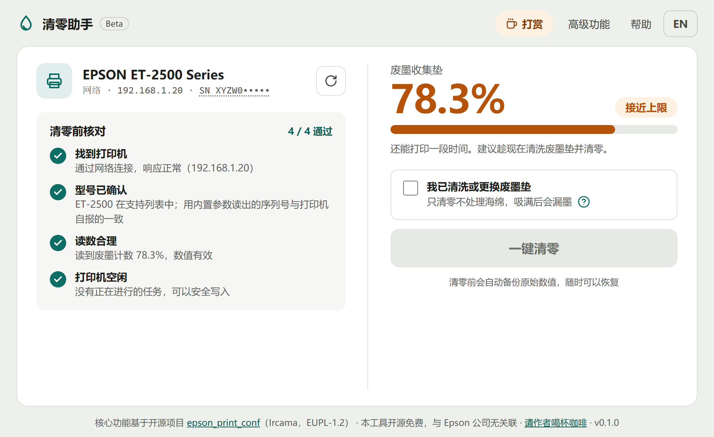
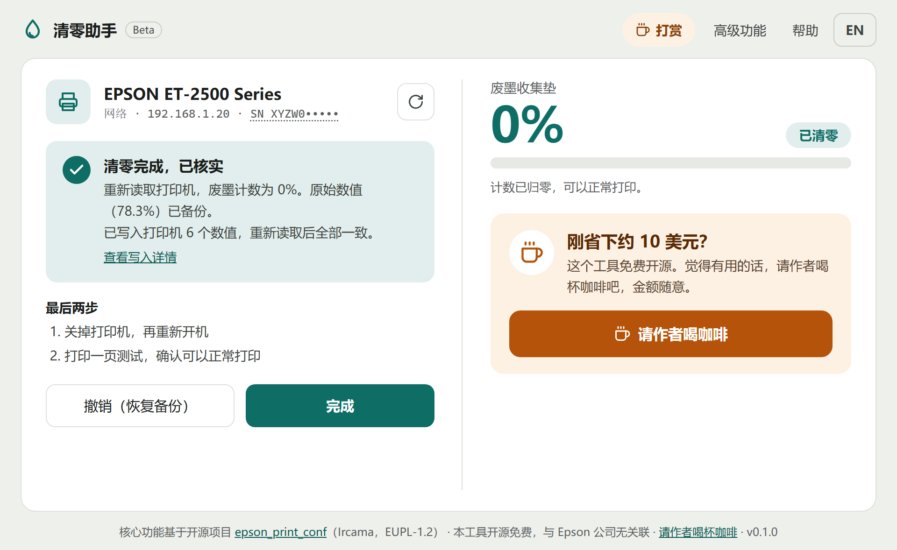
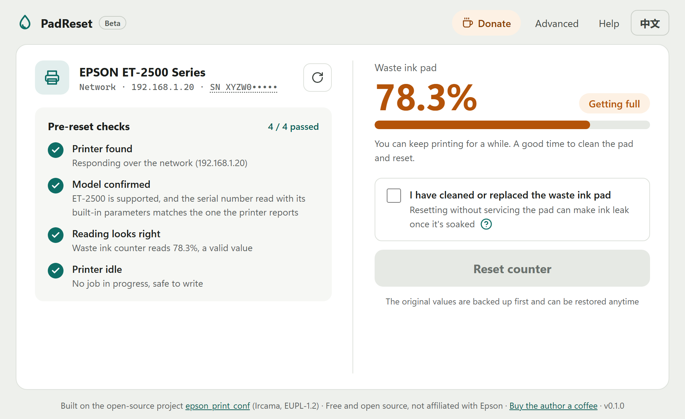

# 清零助手 PadReset

免费开源的爱普生（Epson）打印机废墨计数清零工具 · Free, open-source waste ink pad counter reset for Epson printers

**[⬇ 下载 Download PadReset.exe](https://github.com/Inselfwang/padreset/releases/latest)** · Windows 10/11 · 免安装 / portable · [☕ 打赏 Ko-fi](https://ko-fi.com/inself)



[中文](#中文) · [English](#english)

## 中文

Epson 喷墨打印机内部有一个废墨计数器。计数到上限后，打印机提示“废墨收集垫已到使用寿命”并停止打印，即使你已经清洗或更换了废墨垫。清零助手把这个计数器改回 0：免费、开源、免安装。

**用法**：到 [Releases](https://github.com/Inselfwang/padreset/releases/latest) 下载 `PadReset.exe`，双击运行。它会自动在同一网络里查找打印机，不用填 IP、不用选型号。

> 第一次打开时 Windows 可能提示“Windows 已保护你的电脑”，这是因为本工具没有购买代码签名证书。点“更多信息” → “仍要运行”即可。源代码全部公开，可以自行检查。

1. **查找**：自动扫描同一网络（Wi-Fi 或网线）里的 Epson 打印机
2. **核对**：写入前逐项检查，任何一项不通过就不写
   - 找到打印机，网络响应正常
   - 型号在支持列表中，**并且**用内置参数从芯片里读出的序列号，与打印机自己报告的序列号一致
   - 废墨读数合理
   - 打印机空闲（或因废墨已满而停机）
3. **确认**：勾选“我已清洗或更换废墨垫”后才能清零
4. **清零**：再次核对 → 备份原始数值到本机 → 写入 → 重新读取核实
5. **撤销**：随时可以恢复备份



型号不在支持列表、或参数核对不上时，会如实说明，**不会猜参数**。目前支持 epson_print_conf 已验证的 100 多款网络连接型号；USB 连接暂不支持。

备份和日志保存在 `%APPDATA%\PadReset`。

## English

Epson inkjet printers keep an internal waste ink counter. When it hits its limit, the printer stops printing and says the ink pad has reached the end of its service life, even after you've cleaned or replaced the pad. PadReset sets that counter back to 0. It's free, open source and portable (no install).



**Usage**: download `PadReset.exe` from [Releases](https://github.com/Inselfwang/padreset/releases/latest) and run it. On first launch Windows SmartScreen may say "Windows protected your PC" because the exe isn't code-signed: click "More info" → "Run anyway". All source code is public. It finds printers on your network by itself, with no IP address or model to enter.

1. **Find**: scans your network (Wi-Fi or cable) for Epson printers
2. **Check**: nothing is written unless every check passes
   - the printer responds over the network
   - the model is supported **and** the serial number read from its EEPROM with the built-in parameters matches the serial the printer reports itself
   - the waste ink reading makes sense
   - the printer is idle (or stopped because the counter is full)
3. **Confirm**: tick "I have cleaned or replaced the waste ink pad"
4. **Reset**: re-check, back up the original values to this computer, write, read back and verify
5. **Undo**: restore the backup anytime

If the model isn't supported or the parameters don't check out, PadReset says so and **never guesses parameters**. It supports the 100+ network-connected models verified by epson_print_conf. USB isn't supported yet.

Backups and logs are kept in `%APPDATA%\PadReset`.

## Build from source

```powershell
py -3.12 -m venv .venv
.\.venv\Scripts\python.exe -m pip install -r requirements.txt pyinstaller pytest
.\.venv\Scripts\python.exe -m padreset          # run
.\build.ps1                                      # tests + dist\PadReset.exe
```

UI work without a printer: serve `padreset/ui` and open `index.html?mock=supported` (also `unsupported`, `notfound`, `multi`, `busy`, `fail`).

## Following upstream

`third_party/epson_print_conf` is an unmodified copy of an upstream release (see `UPSTREAM.txt`). The app never downloads printer parameters at run time: new parameters reach users only through a release that passed the tests.

```powershell
.\.venv\Scripts\python.exe tools\update_upstream.py           # newer release available?
.\.venv\Scripts\python.exe tools\update_upstream.py --verify  # is our copy identical to upstream?
.\.venv\Scripts\python.exe tools\update_upstream.py --apply   # update, list changed models, run tests
```

On GitHub, `.github/workflows/upstream-check.yml` checks every Monday and opens an issue when upstream has a new release.

## Credits and licence

- Core printer logic: [epson_print_conf](https://github.com/Ircama/epson_print_conf) by Ircama, EUPL-1.2, vendored unmodified in `third_party/`. See [NOTICE.md](NOTICE.md).
- PadReset is licensed under EUPL-1.2 ([LICENSE](LICENSE)).
- Not affiliated with Seiko Epson Corporation.
